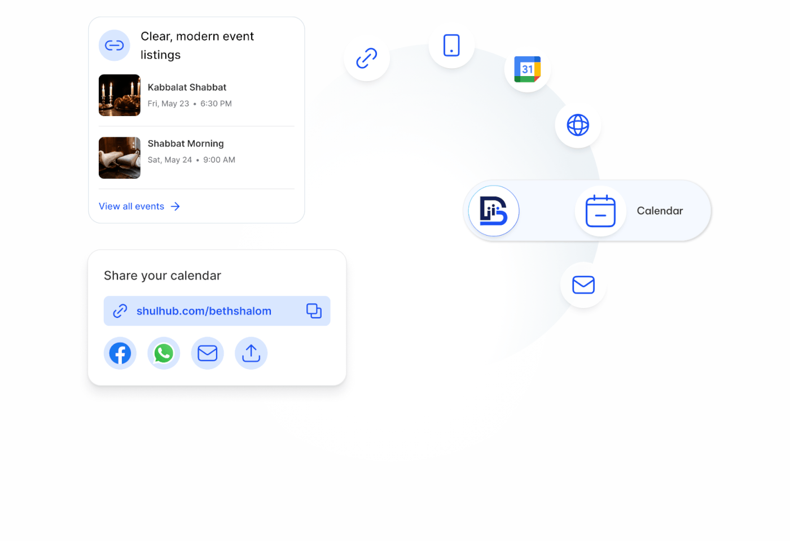

# Sharing feature illustration with cards and a curved arc of round icons

**Discipline:** web ·  · **Design style:** Playful & Illustrated
**Tags:** illustration, feature, white, blue, icons, arc, integration, cards

## What it is
A white area with two cards at left (event listing with thumbnails, share link with social icons) and, at right, a pale arc of circular blue-outline icons (link, phone, calendar, web, mail) ending in a long pill with the product logo and 'Calendar'.

## What it means
Clean and explanatory; the arc shows one calendar flowing to many channels.

## Techniques
- Arrange circular icons along a soft arc to show distribution.
- End the arc with a large pill carrying the product.
- Use tiny UI cards with thumbnails to illustrate outputs.
- Keep everything in blue outline on white.

## Best for
- Feature and integration sections
- SaaS explainer illustrations
- Distribution and sharing concepts

## Vocabulary
- **Icon arc** — Icons arranged along a curve.
- **Output card** — A mini UI card showing a result.
- **Product pill** — A long capsule with a logo and label.
- **Outline icon** — A pictogram drawn with line only.
