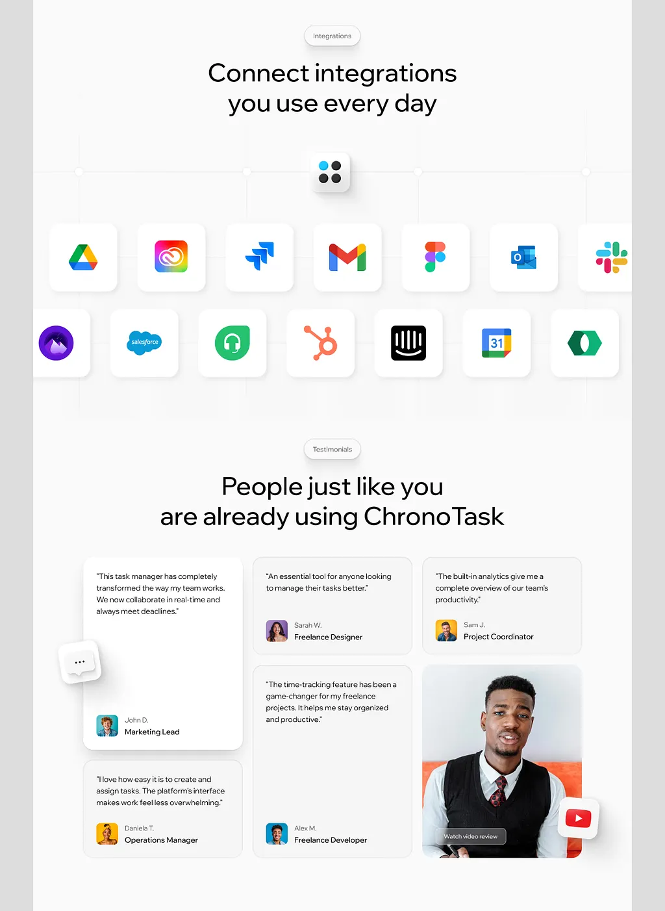

# Integrations section with two rows of white app-icon tiles under a grid, and a testimonial bento with a video card

**Discipline:** web ·  · **Design style:** Geometric & Bauhaus
**Tags:** saas, integrations, white, app-icons, testimonials, bento, video-review, light

## What it is
A white page with an 'Integrations' pill, 'Connect integrations you use every day', a logo tile at the top of a faint grid and two rows of white rounded tiles with colourful app icons (Drive, Creative Cloud, Jira, Gmail, Figma, Outlook, Slack, Salesforce, HubSpot, Intercom...), then 'People just like you are already using ChronoTask' with a bento of white testimonial cards, a chat-bubble tile and a video review card with a play badge.

## What it means
Clean and trustworthy; colourful icons on white tiles show breadth without clutter.

## Techniques
- Show integrations as soft tiles with shadows.
- Tie tiles to a top logo with grid lines.
- Use a bento for quotes with a video card.
- Add a floating chat tile.

## Best for
- SaaS integrations sections
- Testimonial bento
- Light productivity sites

## Vocabulary
- **Icon tile** — A rounded white tile holding an app icon.
- **Grid line backdrop** — Faint lines connecting elements.
- **Video review card** — A testimonial card with a play button.
- **Floating chat tile** — A speech-bubble tile outside a card.
