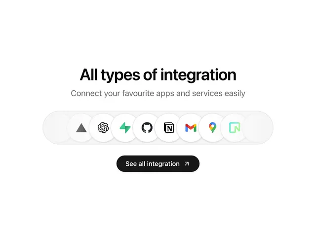

# 'All types of integration' heading over a soft grey capsule track of overlapping white round app logos, with a black See all pill

**Discipline:** web ·  · **Design style:** Minimalist
**Tags:** integrations, logos, pill, white, grey, black-button, centered, minimal

## What it is
A white page with a bold centred heading, a grey subline, a long pale grey capsule holding a row of overlapping white circles with app logos (Vercel, ChatGPT, Supabase, GitHub, Notion, Gmail, Maps, Neon) and a black rounded 'See all integration' button with an arrow.

## What it means
Clean and quick; a compact logo track proves compatibility at a glance.

## Techniques
- Overlap round white logo chips.
- Sit them in a recessed capsule track.
- Fade the ends of the track.
- Add one black pill button.

## Best for
- Integrations sections
- Logo tracks
- Minimal marketing pages

## Vocabulary
- **Logo chip** — A round white disc holding a logo.
- **Recessed track** — A pale capsule holding a row of items.
- **Overlap stack** — Items slightly overlapping in a line.
- **See-all button** — A button leading to the full list.
