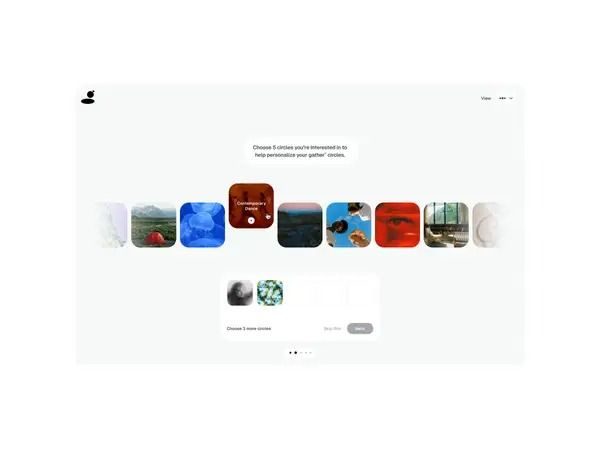

# Interest Picker Carousel of Photo Tiles

**Discipline:** web ·  · **Design style:** Geometric & Bauhaus
**Tags:** picker, carousel, photo-tiles, onboarding, minimal, personalisation, desktop

## What it is
A pale desktop screen with a centred prompt asking users to choose five interests, a horizontal row of rounded photo tiles fading at the edges with one highlighted red tile, and a tray below holding selected choices and a disabled Next button.

## What it means
Big image tiles make choosing feel like browsing, and edge fades suggest a long list.

## Techniques
- Row of photo tiles fading at both edges
- Enlarged highlighted tile under the cursor
- Selection tray with empty slots and counter
- Disabled button until enough choices
- Pagination dots below

## Best for
- Personalised onboarding
- Interest and topic selection
- Community and content platforms

## Vocabulary
- **Tile picker** — A selection UI built from image tiles.
- **Edge fade** — Items fading out at the edges of a scroll row.
- **Selection tray** — A panel showing the items chosen so far.
