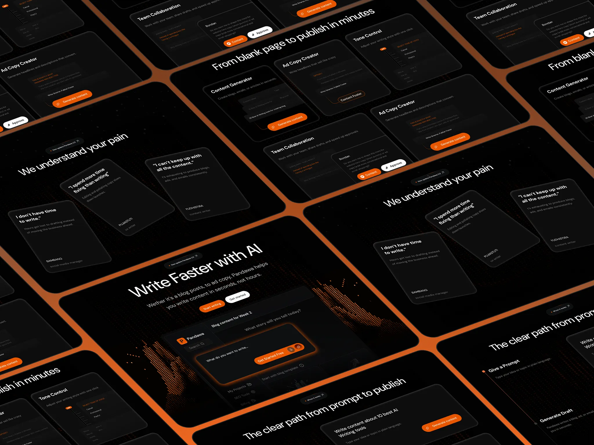

# Isometric wall of dark AI-writing screens separated by orange grout lines

**Discipline:** web ·  · **Design style:** Geometric & Bauhaus
**Tags:** saas, ai, dark, orange, isometric, screens, perspective, wall

## What it is
A field of black rounded UI screens rotated in isometric perspective and tiled with orange gaps: hero 'Write Faster with AI' with dotted hands, feature cards, tone controls, pain quotes and step flows with orange buttons.

## What it means
Powerful and immersive; the tiled wall shows the whole site as an environment.

## Techniques
- Tile screens in isometric perspective.
- Use orange as grout between panels.
- Keep UI dark with orange buttons.
- Crop to suggest endless screens.

## Best for
- Website case-study overviews
- AI and SaaS launch visuals
- Dark orange brands

## Vocabulary
- **Isometric wall** — Screens tiled in angled perspective.
- **Grout lines** — Coloured gaps between tiles.
- **Screen overview** — A composite showing many pages at once.
- **Orange accent** — Orange used for buttons on dark UI.
