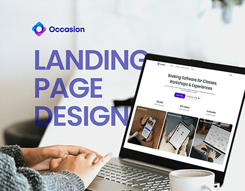

# 'LANDING PAGE DESIGN' in big violet-blue letters beside a laptop showing a booking site, with hands and coffee

**Discipline:** web ·  · **Design style:** Glassmorphism
**Tags:** landing-page, cover, violet, white, laptop, hands, coffee, photo

## What it is
A blurred bright desk scene with hands in a grey sweater on a laptop showing a white booking-software page, a coffee cup, a small logo at the top left and giant violet-blue heavy 'LANDING PAGE DESIGN' overlapping the laptop's left edge.

## What it means
Friendly and clear; the label and screen tell the project in one glance.

## Techniques
- Overlay giant heavy title text on a photo.
- Show the site on a real laptop.
- Keep the scene bright and blurred.
- Use one brand colour for the text.

## Best for
- Web project thumbnails
- Landing page portfolio covers
- Bright desk scenes

## Vocabulary
- **Title over mockup** — Large text partly overlapping a laptop.
- **Desk scene** — A mockup on a real work desk.
- **Blurred backdrop** — An out-of-focus background.
- **Project label** — Text naming the deliverable.
