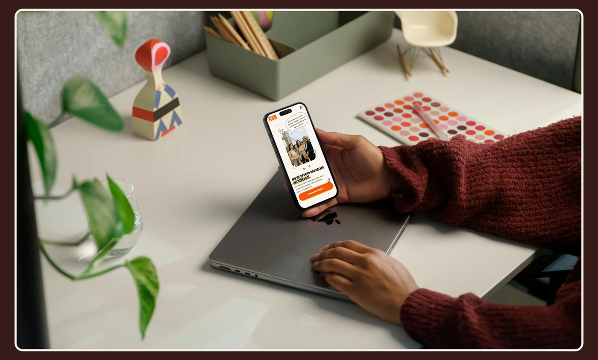

# Orange-and-cream language-school site on a phone held above a laptop among desk objects

**Discipline:** web ·  · **Design style:** Warm & Organic
**Tags:** mobile-web, mockup, desk, hand, maroon-sweater, plants, cream-frame, education

## What it is
A top-down desk scene with hands in a burgundy sweater holding a phone showing an orange-cream school site, a closed laptop, a colour palette, a plant in glass, a folk-art figure and a pen tray, framed with a cream keyline on brown.

## What it means
Human and creative; props and warm tones make the site feel at home.

## Techniques
- Match sweater and frame to brand brown.
- Use creative desk props.
- Show hands in action.
- Keep the phone the focal point.

## Best for
- Web project covers
- Educational brand presentations
- Desk-scene mockups

## Vocabulary
- **Desk scene** — A mockup on a styled desk.
- **Prop styling** — Objects that set mood.
- **Hands-in-frame** — Hands interacting with the device.
- **Cream keyline** — A thin pale border.
