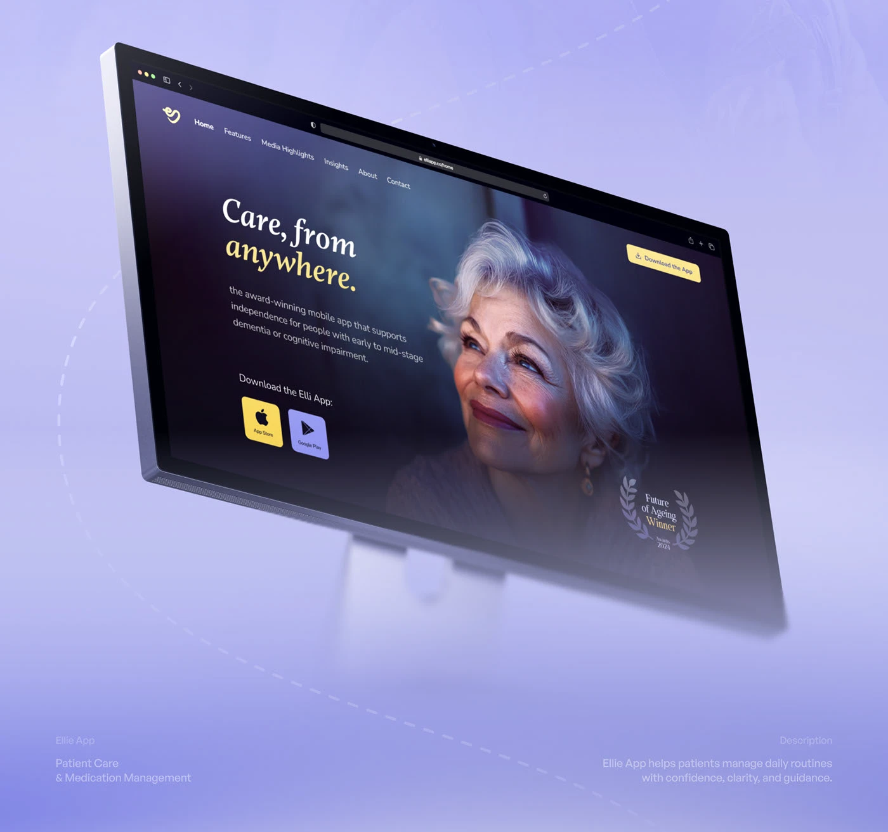

# Care App Site on a Tilted Monitor

**Discipline:** web ·  · **Design style:** Dark & Neon
**Tags:** monitor, tilted, lavender, dark-ui, yellow, portrait, dashed-line

## What it is
A lavender scene with a monitor tilted in perspective showing a dark indigo landing page with a serif italic headline 'Care, from anywhere.' with a yellow second line, a portrait of a smiling older woman, yellow and lilac store buttons and an award laurel, with a dashed loop around the monitor and captions at the bottom corners.

## What it means
A dark site glowing in a pale lavender scene stands out, and the yellow accent adds warmth.

## Techniques
- Steep perspective tilt with a fading base
- Dark UI against a pale scene
- Yellow accent for key words and buttons
- Dashed loop drawn around the device
- Project name and description in the corners

## Best for
- Care and health website presentations
- Warm dark-on-light contrast covers
- Tilted monitor mockups

## Vocabulary
- **Perspective tilt** — A device rotated in 3D to add dynamism.
- **Award laurel** — A wreath around an award name.
- **Corner captions** — Small labels at the bottom corners of a cover.
