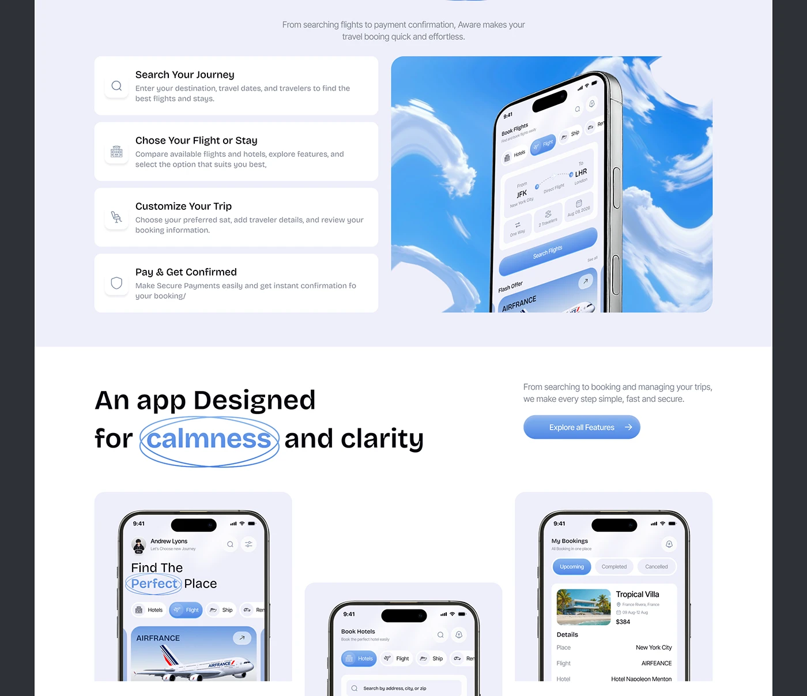

# Travel App Steps and Calm Clarity Sections

**Discipline:** web ·  · **Design style:** Minimalist
**Tags:** travel, lavender, cards, steps, circled-word, phones, sky

## What it is
A cropped travel landing page: a lavender section with four numbered step cards beside a phone over swirling clouds, then a white section with the headline 'An app Designed for calmness and clarity' with a circled word, an Explore all Features button and three phone tiles.

## What it means
Icon steps beside a cloud-backed phone explain the flow, and the circled word adds a human touch.

## Techniques
- Step cards with icon tiles
- Phone in front of stylised clouds
- Hand-drawn double ellipse around a word
- Phone tiles on lilac panels
- Blue pill call to action

## Best for
- Travel and booking landing pages
- How-it-works sections
- Feature section pairs

## Vocabulary
- **Step card** — A card with an icon, title and short description of one step.
- **Cloud backdrop** — Stylised clouds used behind a phone.
- **Feature tiles** — Panels each holding a phone screen.
