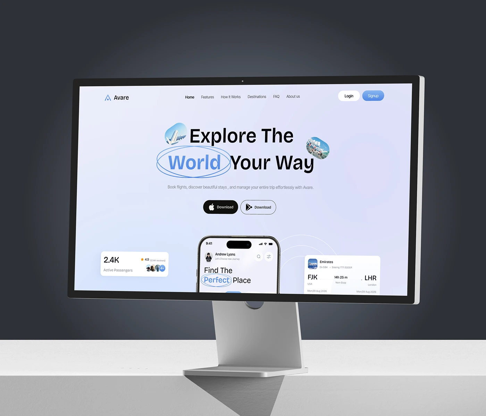

# Travel Landing Page on Desktop Monitor

**Discipline:** web · **Design type:** Device mockup scene
**Tags:** monitor, travel, lavender, circled-word, dark-backdrop, hero, white-desk

## What it is
A silver monitor on a white desk against a dark slate backdrop showing a lavender travel landing page with a circled word in the headline, store buttons, a stats card, a phone preview and a flight card.

## What it means
The dark backdrop makes the pale interface glow, and the studio desk gives a clean, premium presentation.

## Techniques
- Dark to light split between backdrop and desk
- Pale gradient page that contrasts with the dark scene
- Hand-drawn ellipse around a headline word
- Small floating cards around a centre phone
- Dual store-download buttons under the headline

## Best for
- Website case-study presentations
- Travel and consumer app landing pages
- Clean desktop mockups

## Vocabulary
- **Studio mockup** — A device on a clean desk with controlled lighting.
- **Circled word** — A word ringed with a hand-drawn ellipse.
- **Preview cluster** — Small cards and phone previews grouped around a hero.
