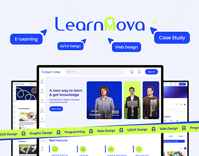

# LearnNova e-learning case study cover with cursor tag labels and a yellow caution-tape banner

**Discipline:** web · **Design type:** Project cover · **Design style:** Corporate & Clean-Tech
**Tags:** e-learning, blue, lime, tape, case-study-cover, dashboard

## What it is
A pale lavender cover with the 'LearnNova' wordmark (lightbulb 'N'), blue pill labels with cursor arrows (E-Learning, UI/UX Design, Web Design, Case Study), a desktop screen of the learning dashboard with mentor photos, and a lime tape strip repeating the disciplines across the bottom.

## What it means
Energetic and organised; cursor labels feel like a live design file.

## Techniques
- Label a cover with Figma-style cursor tags.
- Run a repeating tape strip across the bottom.
- Frame the main screen between cropped side screens.

## Best for
- E-learning platforms
- Portfolio case study covers
- Education startups

## Vocabulary
- **Cursor tag** — A pill with a pointer like a collaborator's cursor.
- **Tape banner** — A strip of repeated text like barrier tape.
