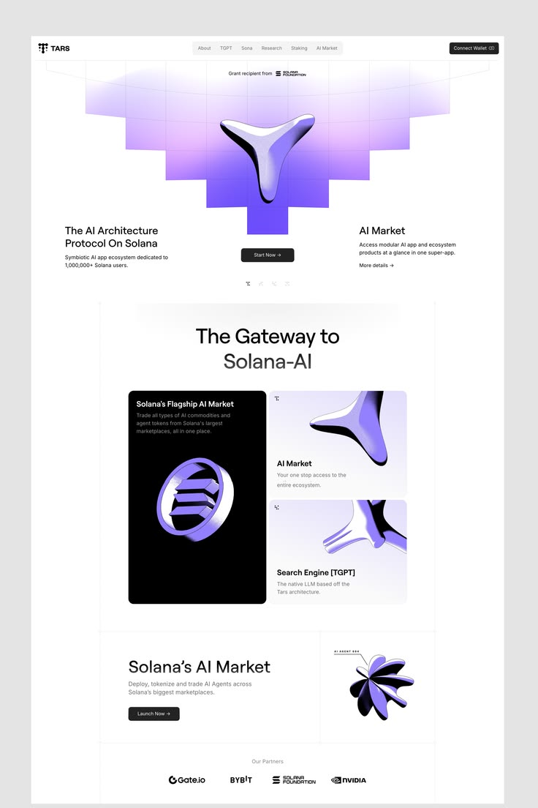

# Lilac 3D Chrome AI Protocol Landing Page

**Discipline:** web · **Design type:** Landing page
**Tags:** ai, lilac, chrome, 3d, stepped-gradient, black-card, web3, long-page

## What it is
A white landing page with a hero of a stepped lilac-to-violet gradient shape holding a chrome tri-blade 3D object, a two-column headline and text, a 'Gateway' section with a black card holding a ringed chrome logo and two lilac cards with chrome shapes, and an AI market section with a rosette and a partners row.

## What it means
Glossy chrome objects on lilac give a futuristic, precious feel, and the black card is a strong anchor.

## Techniques
- Stepped pixel-like gradient staircase behind a 3D object
- Chrome and violet 3D objects as brand illustrations
- One black card among pale lilac cards
- Minimal nav pill and dark CTA buttons
- Partner logos row at the base

## Best for
- AI and web3 landing pages
- 3D object-led hero sections
- Crypto ecosystem sites

## Vocabulary
- **Stepped gradient** — A gradient built from stacked blocks that step in size.
- **Chrome object** — A reflective metallic 3D form.
- **Anchor card** — A dark card placed among light ones for weight.
