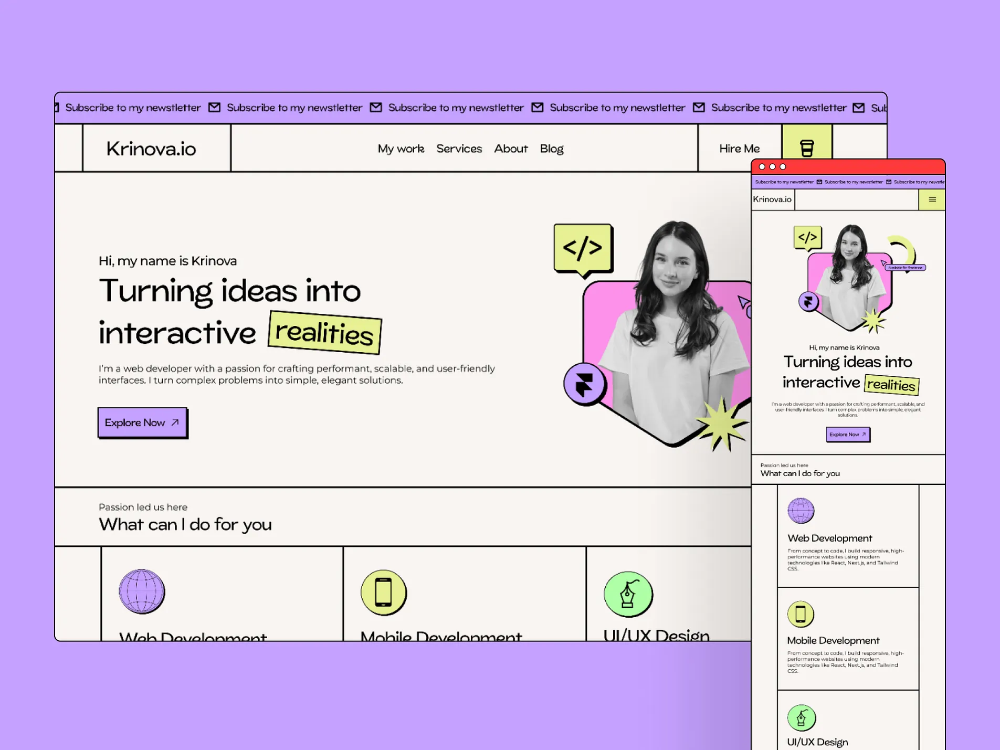

# Developer portfolio hero with hard grid lines, marquee and sticker portrait

**Discipline:** web · **Design type:** Portfolio site
**Tags:** portfolio, neo-brutalism, lilac, lime, marquee, grid-lines, sticker, responsive

## What it is
On a lilac background sit a desktop and mobile site. A ticking marquee strip says 'Subscribe to my newsletter', the header is boxed by black lines, the hero has a friendly headline with the word 'realities' highlighted in a tilted lime label, and a monochrome portrait sits in a pink shape with code and tool stickers.

## What it means
Confident, quirky and approachable, with the grid giving it a raw, blueprint feel.

## Techniques
- Frame every section with hard black lines to create a visible grid.
- Run a marquee ticker at the top for a promo message.
- Highlight one word in a tilted label like a sticker.
- Place a greyscale portrait in a colourful hex shape ringed by tool icons.
- Use offset-shadowed buttons.

## Best for
- Developer and designer portfolios
- Personal brand sites
- Startups wanting a playful brutalist vibe

## Vocabulary
- **Marquee strip** — A scrolling text band across the top or bottom.
- **Boxed layout** — Sections divided by visible rules.
- **Tilted highlight** — A word on a rotated colour block.
- **Greyscale cutout** — A black and white portrait against colour.
