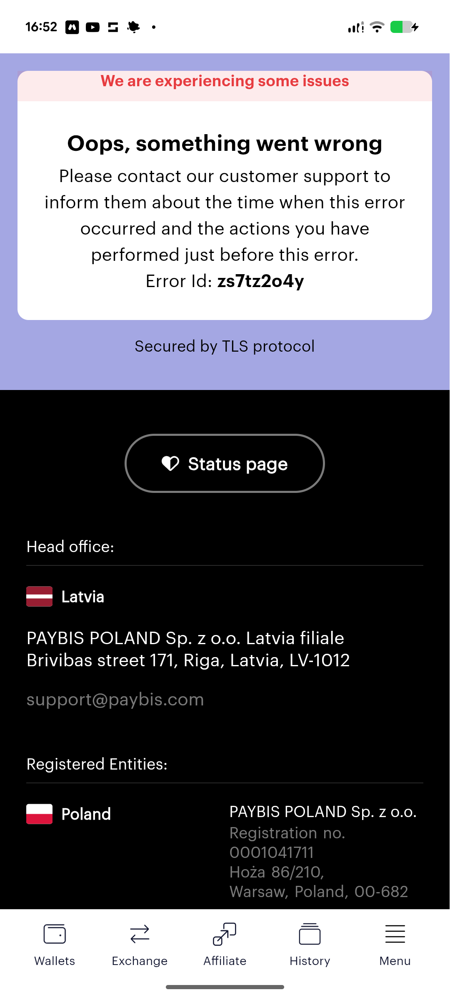

# Lilac Error Card with Black Footer

**Discipline:** web · **Design type:** Error page
**Tags:** error, lilac, black, status, footer, pill-button, bottom-nav

## What it is
A mobile error screen on lilac with a white rounded card topped by a pink strip reading 'We are experiencing some issues', a bold 'Oops, something went wrong' heading, plain instructions and an error ID, then a black footer with an outlined Status page pill, office and registered entity details with country flags and a five-item bottom tab bar.

## What it means
A calm lilac card and a clear error ID make a failure feel handled, and the status link gives the user somewhere to go.

## Techniques
- Pink alert strip on top of a white card
- Bold heading followed by plain instructions
- Error ID in bold for support
- Outlined pill for the status page
- Black footer with flags and legal details

## Best for
- Error and outage states
- Fintech and exchange apps
- Support-oriented messages

## Vocabulary
- **Error ID** — A code the user can quote to support.
- **Alert strip** — A coloured band on a card announcing a status.
- **Status page** — A page showing whether services are working.
