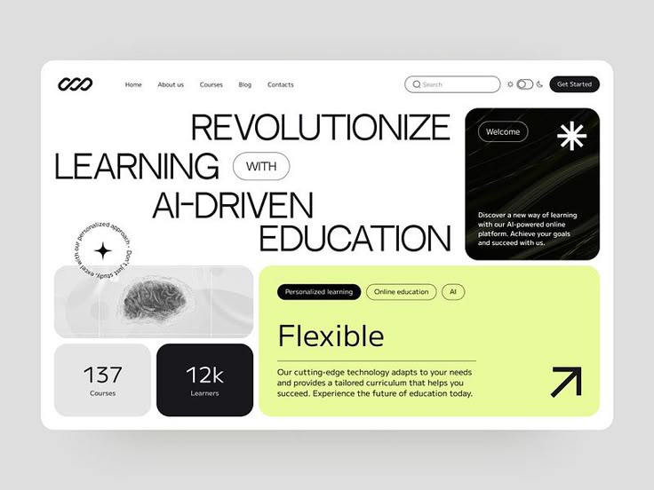

# AI Learning Bento Hero in Lime

**Discipline:** web ·  · **Design style:** Geometric & Bauhaus
**Tags:** bento, lime, black, ai, education, light-type, brain, stats

## What it is
A white landing hero with a huge thin uppercase headline 'Revolutionize learning with AI-driven education' and a bento of tiles: a black welcome card with an asterisk, a circular text badge, a greyscale brain image, two stat tiles and a large lime 'Flexible' feature tile.

## What it means
Thin oversized type with a tight mix of black, grey and lime tiles feels editorial and modern, and the bento organises many ideas cleanly.

## Techniques
- Wide thin uppercase headline with an outlined pill inside the sentence
- Bento tiles in black, grey and lime
- Circular rotating text badge as a decorative detail
- Greyscale image tile against the lime tile
- Small tag pills and an arrow icon for the CTA

## Best for
- Education and AI platforms
- Editorial hero sections
- Product pages with multiple key messages

## Vocabulary
- **Inline pill** — A rounded outlined word inside a headline.
- **Circular badge** — A round graphic with text wrapped around its edge.
- **Feature tile** — A bento tile dedicated to one key benefit.
