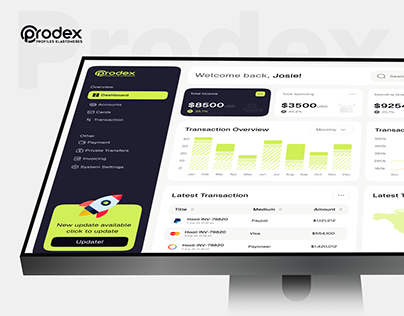

# Lime Fintech Dashboard on Monitor

**Discipline:** web ·  · **Design style:** Corporate & Clean-Tech
**Tags:** monitor, dashboard, lime, dark-sidebar, ghost-type, logo, cover

## What it is
A cover with a giant faint 'Prodex' behind a monitor showing a white finance dashboard with a dark sidebar, lime highlight bars and an update card, with a black-and-lime logo top left.

## What it means
Lime bars against a dark sidebar and white content give a fresh, energetic look for money data.

## Techniques
- Ghost brand name behind the screen
- Dark sidebar with a lime rocket update card
- Lime bars in a bar chart
- Black balance card with a lime tag
- Simple monitor on a plain white ground

## Best for
- Fintech dashboard covers
- Lime and black brand systems
- Clean monitor mockups

## Vocabulary
- **Sidebar update card** — A promo card in the sidebar announcing an update.
- **Lime accent** — A neon yellow-green used for highlights.
- **Ghost name** — Oversized faint brand text behind a subject.
