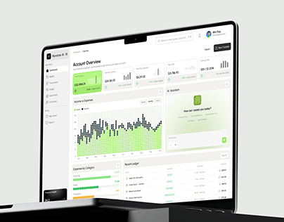

# Lime Finance Dashboard with AI Assistant

**Discipline:** web ·  · **Design style:** Corporate & Clean-Tech
**Tags:** dashboard, lime, white, laptop, finance, ai-assistant, dot-chart

## What it is
A laptop on a dark plinth showing a light finance dashboard with lime KPI cards, a dotted income and expense chart, a green AI assistant panel and a recent ledger table.

## What it means
Lime accents on white and grey feel fresh and modern for finance, and the dot chart adds texture.

## Techniques
- Lime highlight card for the main balance
- Dot-matrix area chart in lime and black
- Green assistant panel with a friendly prompt
- Grouped sidebar with small labels
- Laptop on a dark plinth for contrast

## Best for
- Finance and accounting dashboards
- AI assistant panels in web apps
- Light dashboards with one accent

## Vocabulary
- **Dot-matrix chart** — A chart made of small dots or squares.
- **Assistant panel** — A panel where an AI helper takes prompts.
- **Plinth** — A block used as a display base.
