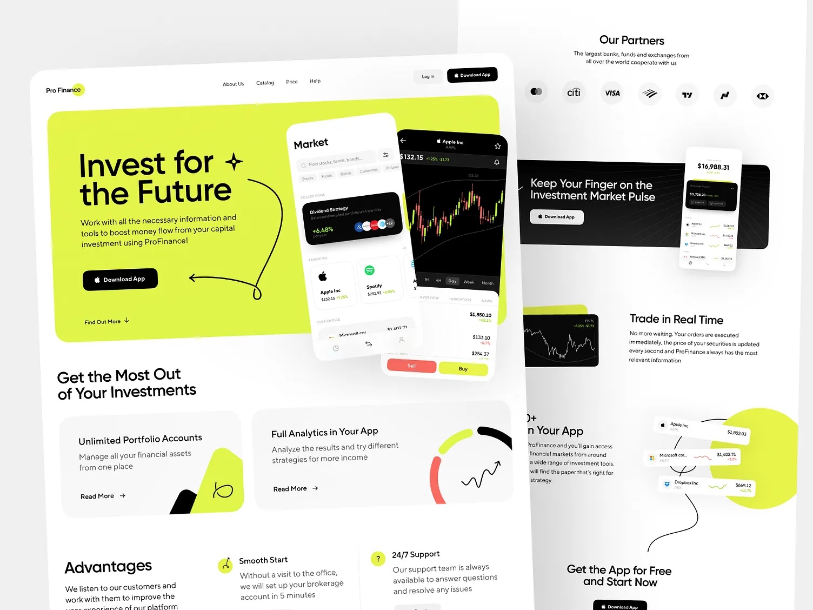

# Investing site with a big lime hero panel, hand-drawn black loop arrows, tilted market phones and bento feature cards

**Discipline:** web ·  · **Design style:** Neo-Brutalist
**Tags:** fintech, investing, lime, black, hand-drawn, tilted-phones, bento, white

## What it is
A white page with a lime rounded hero panel holding a black headline 'Invest for the Future' with a sparkle, a Download App button, a hand-drawn arrow looping around the phones, two tilted phones (market list and candlestick chart) with red Sell and lime Buy buttons, then 'Get the Most Out of Your Investments' with two cards (lime shape, ring chart), advantages with icons, a partners row, a dark app band and a trade section with floating stock cards.

## What it means
Energetic and friendly; hand-drawn arrows make finance feel human.

## Techniques
- Draw loop arrows by hand over the layout.
- Tilt phones over a lime panel.
- Use lime for blobs and highlights.
- Show partners as round logo circles.

## Best for
- Investing and trading apps
- Lime-black-white brands
- Hand-drawn accents on tech sites

## Vocabulary
- **Hand-drawn loop arrow** — A sketchy arrow curling around content.
- **Tilted phones** — Devices rotated over a coloured panel.
- **Buy/Sell pair** — Two colour-coded action buttons.
- **Partner circles** — Logos inside round grey discs.
