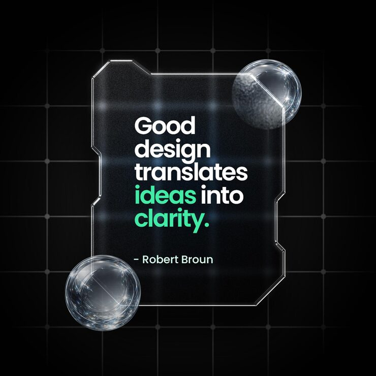

# Liquid-glass quote card on a dark tech grid

**Discipline:** web · **Design type:** UI components · **Design style:** Glassmorphism
**Tags:** glassmorphism, quote card, liquid glass, dark mode, 3d glass, grid

## What it is
A jagged-edged glass panel with a refractive, watery texture floats over a black grid background, holding a quote with glass orb decorations at its corners.

## What it means
The distorted refraction and dark grid evoke a futuristic, tactile surface, giving a plain text quote the weight of a physical object.

## Techniques
- render translucent panels with visible refraction/distortion instead of flat blur
- notch the panel edges irregularly to break the usual glass-rectangle cliché
- anchor the card with small glass sphere props to reinforce the material

## Best for
- tech brand quote graphics
- dark-mode UI kits
- premium/futuristic product marketing

## Vocabulary
- **glassmorphism** — a UI style simulating frosted or refractive glass via blur, transparency and light edges
