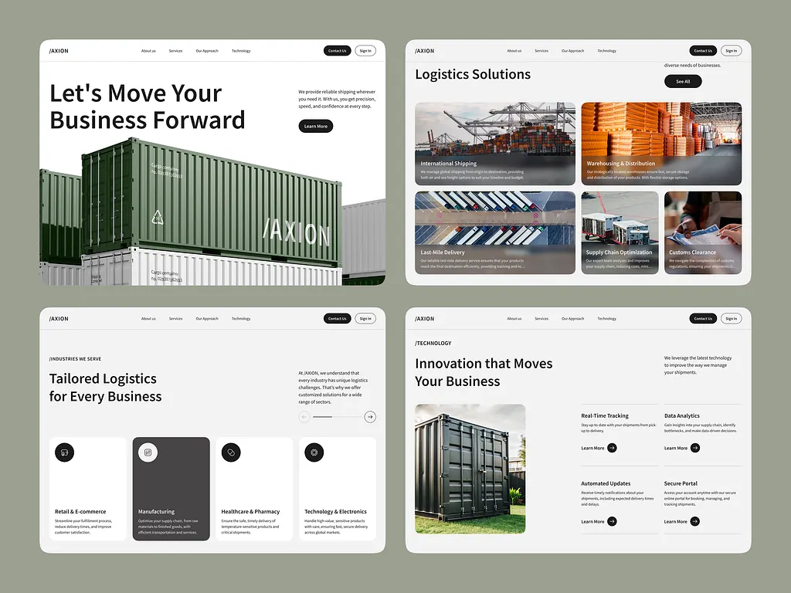

# Sage-green board of four logistics pages: container hero, solutions photo cards, industry cards with one dark, and technology list

**Discipline:** web · **Design type:** Landing page
**Tags:** logistics, sage-green, white, containers, photo-cards, industry-cards, black-buttons, minimal

## What it is
A sage-green board with four white page windows: a hero 'Let's Move Your Business Forward' with a black button and a photo of green and white shipping containers, 'Logistics Solutions' with a bento of photo cards with captions, 'Tailored Logistics for Every Business' with four industry cards where one is dark, and 'Innovation that Moves Your Business' with a container photo and four feature blocks with arrow circles.

## What it means
Clean and reliable; muted green matches the containers and black buttons keep it serious.

## Techniques
- Match the palette to the brand's containers.
- Use dark gradient captions on photo cards.
- Highlight one industry card in dark grey.
- Use hairline-separated feature blocks.

## Best for
- Logistics and industrial sites
- Photo-card bento sections
- Muted green corporate pages

## Vocabulary
- **Photo bento** — A grid of photo cards with different sizes.
- **Industry card** — A card naming a sector with an icon.
- **Arrow circle** — A small circular arrow link.
- **Sage board** — A muted green presentation background.
