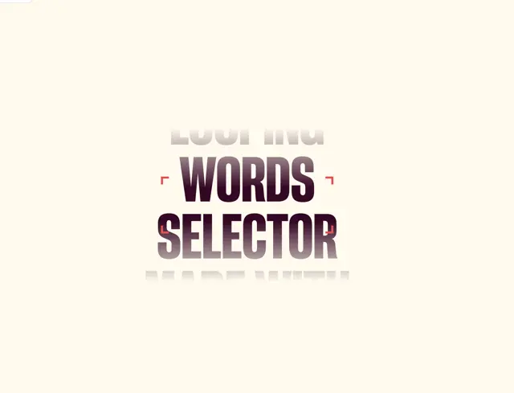

# Cream page with a vertical scroller of heavy condensed words 'WORDS SELECTOR' fading up and down under red corner brackets

**Discipline:** web · **Design type:** Motion text
**Tags:** typography, motion, cream, plum, condensed, fade, corner-brackets, selector

## What it is
A cream page with a centred stack of heavy condensed uppercase words, where the middle two ('WORDS', 'SELECTOR') are plum with a vertical gradient and the lines above and below fade to grey, framed by small red corner brackets like a camera focus.

## What it means
Kinetic and focused; fading neighbours and brackets make one word feel selected.

## Techniques
- Stack words in a vertical scroller.
- Fade the outer lines.
- Frame the selection with red corner brackets.
- Use heavy condensed caps.

## Best for
- Rotating word headlines
- Kinetic typography components
- Selector interactions

## Vocabulary
- **Word scroller** — A vertical list of words that loops.
- **Focus brackets** — Corner marks indicating the selected item.
- **Fade mask** — A gradient hiding the ends of a list.
- **Condensed caps** — Tall narrow uppercase letters.
