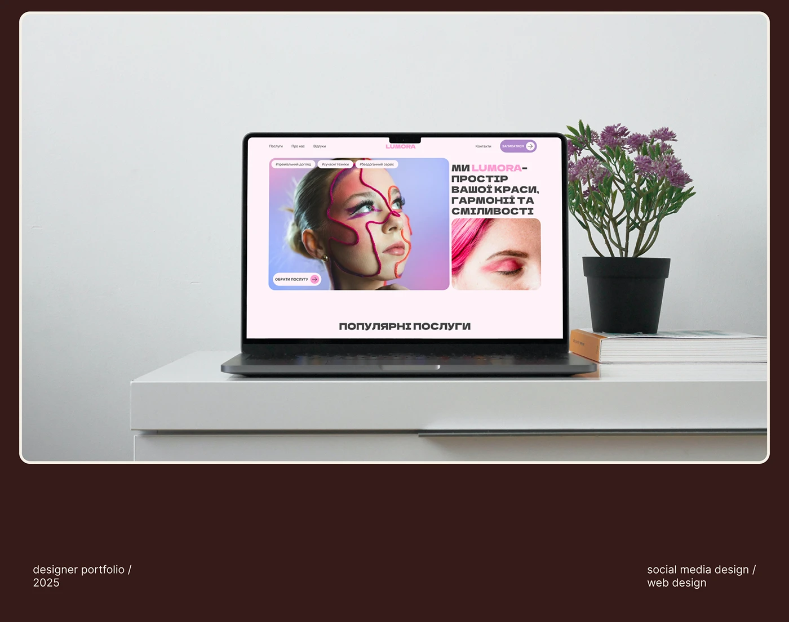

# Pink beauty-salon site on a laptop on a white shelf beside a purple plant, brown frame with credits

**Discipline:** web ·  · **Design style:** Warm & Organic
**Tags:** laptop-mockup, salon, pink, plant, white-desk, brown-frame, credits, portfolio

## What it is
A minimal scene of a laptop with a pink salon hero, a black pot with purple flowers and a book on a white cabinet, inside a cream keyline on brown, with small captions 'designer portfolio / 2025' and 'social media design / web design'.

## What it means
Clean and calm; a white room lets the pink screen stand out.

## Techniques
- Stage in a plain white room.
- Add one plant as colour.
- Frame on brown with cream keyline.
- Add discreet credits.

## Best for
- Portfolio website presentations
- Beauty site covers
- Minimal desk scenes

## Vocabulary
- **White-room mockup** — A device in a plain white space.
- **Accent plant** — A small plant adding colour.
- **Credit captions** — Small text naming year and discipline.
- **Brown slide** — A dark brown presentation background.
