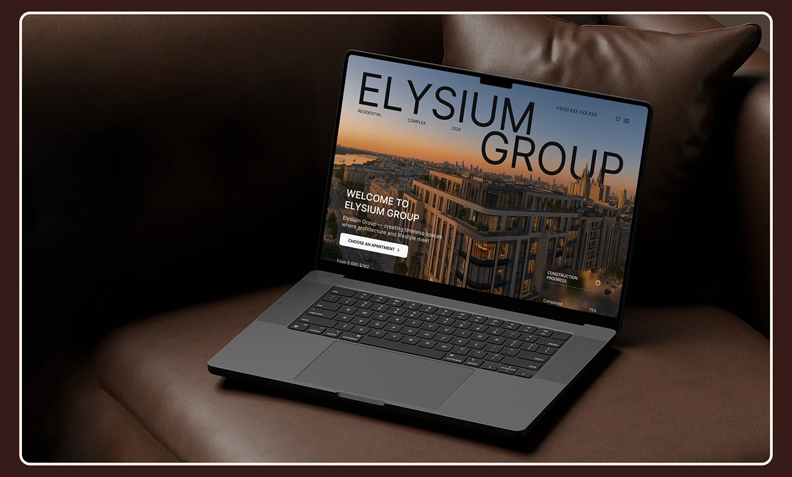

# Real-estate site on a laptop resting on a dark brown leather sofa inside a cream frame

**Discipline:** web ·  · **Design style:** Warm & Organic
**Tags:** laptop-mockup, leather, brown, luxury, real-estate, warm, cream-frame, project-cover

## What it is
A laptop showing a sunset skyline hero with giant 'ELYSIUM GROUP' letters sits on a chocolate leather sofa with a cushion behind, in low warm light, framed by a thin cream rounded line on deep brown.

## What it means
Rich and comfortable; leather and gold-hour skyline signal luxury living.

## Techniques
- Choose a furniture material that matches the brand palette.
- Light low and warm.
- Frame with a thin cream border on the slide colour.
- Let the screen's sunset add the only colour.

## Best for
- Luxury property showcases
- Warm-toned case studies
- Residential brand sites

## Vocabulary
- **Material match** — A scene surface that echoes the palette.
- **Low-key light** — Dim lighting with warm highlights.
- **Cream keyline** — A thin light border around an image.
- **Skyline hero** — A hero built on a city photograph.
