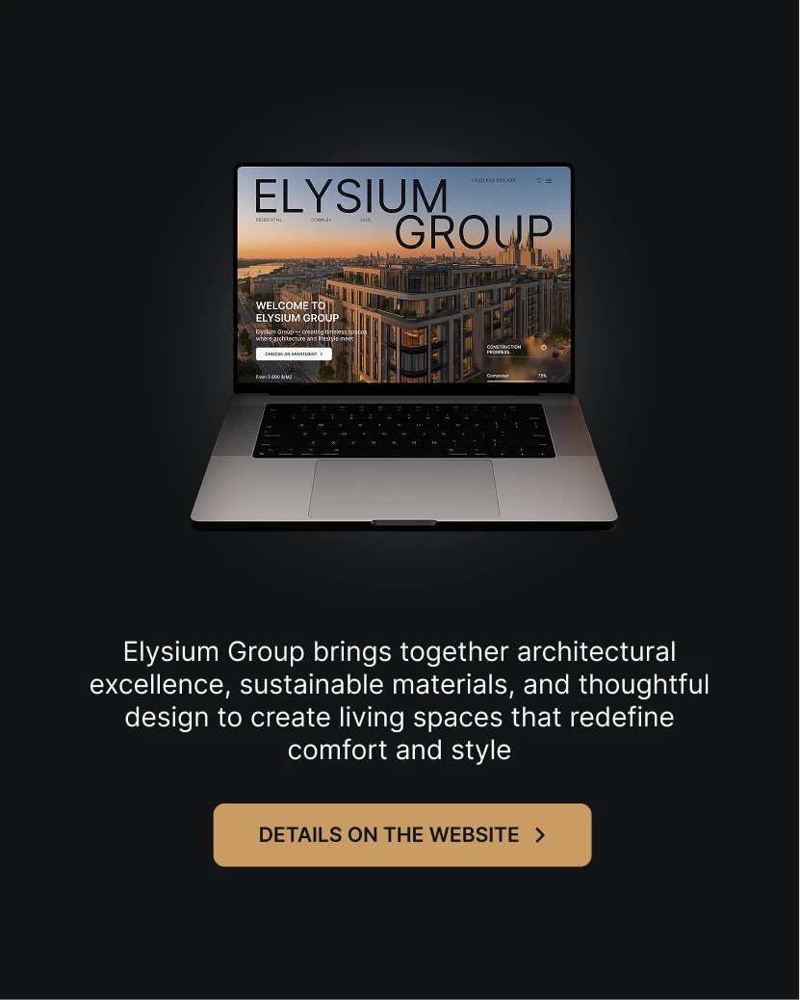

# Dark card with a glowing laptop showing a property site, a paragraph and a gold CTA

**Discipline:** web · **Design type:** Device mockup scene
**Tags:** laptop-mockup, dark, gold, real-estate, luxury, cta, card, centred

## What it is
A near-black square with a laptop glowing on a faint light halo showing a big 'ELYSIUM GROUP' hero over a sunset skyline, a white centred paragraph and a tan gold button 'DETAILS ON THE WEBSITE'.

## What it means
Refined and expensive; black and gold feel like a luxury showroom.

## Techniques
- Show a glowing device on black.
- Use a single gold button.
- Centre light-weight white copy.
- Keep the layout symmetrical.

## Best for
- Luxury real-estate posts
- Website teaser cards
- Dark premium promos

## Vocabulary
- **Device halo** — A soft glow behind a device.
- **Gold CTA** — A tan or gold action button.
- **Symmetrical stack** — Elements centred vertically.
- **Showroom dark** — A black backdrop for luxury.
