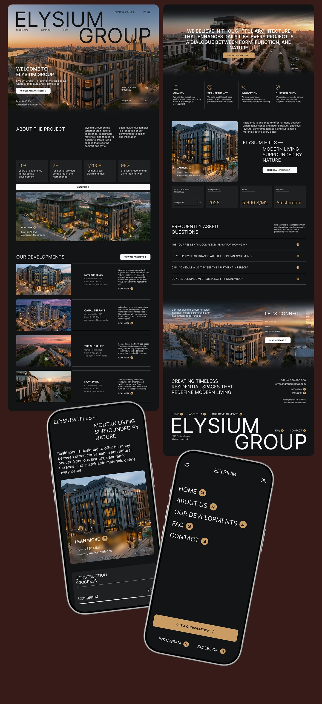

# Dark residential developer site with a giant cropped ELYSIUM GROUP title, stat tiles, project list and gold mobile CTA

**Discipline:** web ·  · **Design style:** Geometric & Bauhaus
**Tags:** real-estate, dark, gold, giant-type, stat-tiles, project-list, faq, mobile

## What it is
A dark brown board with two long page columns and two tilted phones: a hero of a dusk building with a huge light 'ELYSIUM GROUP', About with stat tiles (10+, 7+, 1,200+, 98%), a project list with photo rows, value icons, a project feature, FAQ accordion, contact over a skyline, a giant footer name, and phones with an overview and a full-screen menu with a gold 'Get a consultation' button.

## What it means
Refined and premium; warm gold on near-black feels like luxury living.

## Techniques
- Split a giant wordmark across the hero.
- List developments as photo rows with hairlines.
- Use one gold button.
- Show menu as huge stacked words on mobile.

## Best for
- Luxury property developers
- Dark gold sites
- Full site and mobile presentations

## Vocabulary
- **Cropped giant title** — A huge name partially cut by the hero.
- **Stat tile** — A dark tile with a number and label.
- **Project row** — A photo with name and details in a list.
- **Stacked menu** — A menu of large words on mobile.
