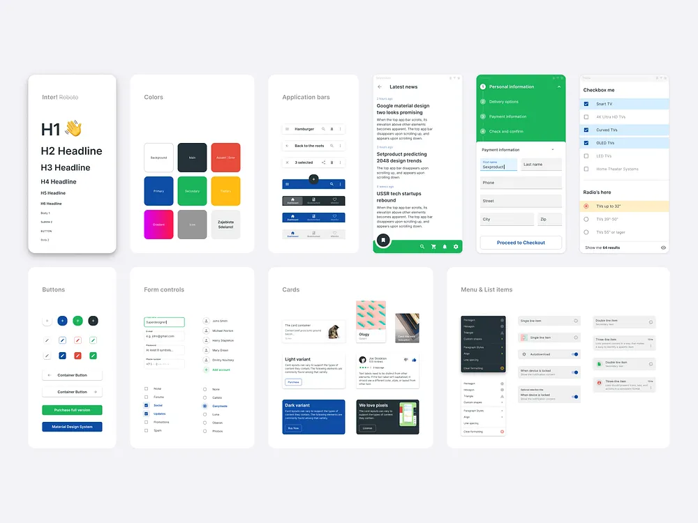

# Material-Style UI Kit Overview

**Discipline:** web ·  · **Design style:** Geometric & Bauhaus
**Tags:** ui-kit, material, typography, colours, forms, cards, lists, checkboxes

## What it is
A pale board of white panels showing a UI kit: Inter headings H1 to H6, a colour palette (blue, green, red, yellow, magenta gradient), application bars, a news feed with a green nav bar, a checkout stepper, checkboxes and radios, buttons, form controls, cards in light and dark variants and menu and list items.

## What it means
Showing every component category in tiles on one board gives a complete overview of the system in a familiar Material style.

## Techniques
- One panel per component category
- Primary colours as coloured square swatches
- Light and dark variants of cards
- Stepper with numbered sections
- Consistent panel size and radius

## Best for
- Design-system overviews
- UI kit previews
- Material Design references

## Vocabulary
- **Type ramp** — A list of heading and body styles from H1 downward.
- **Application bar** — A bar at the top of a screen with title and actions.
- **Stepper** — A component showing progress through numbered steps.
