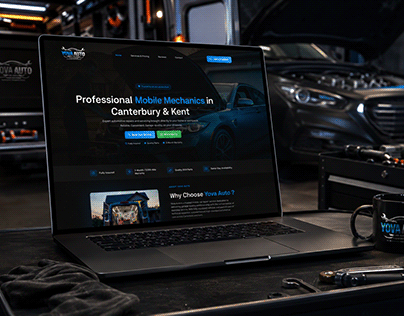

# Dark mobile-mechanic website on a laptop among car tools in a workshop

**Discipline:** web · **Design type:** Device mockup scene
**Tags:** laptop-mockup, garage, dark, blue, service-site, tools, car, project-cover

## What it is
A laptop on a dark workbench with a mug, tools and a cloth, a sports car in the background. The screen shows a dark page with a blue-highlighted headline 'Professional Mobile Mechanics', blue and green buttons and a photo card.

## What it means
Practical and moody; the site looks at home in the workshop it advertises.

## Techniques
- Stage the mockup in the service's real environment.
- Match dark UI to dark scene with a blue accent.
- Use props like tools to add narrative.
- Keep the screen readable with high contrast type.

## Best for
- Trades and automotive service sites
- Dark UI case studies
- Local business web design

## Vocabulary
- **Environmental staging** — Placing a mockup in a scene from the client's industry.
- **Workbench prop** — Tools used as storytelling elements.
- **Blue highlight** — A key word coloured in the accent.
- **Dark UI** — An interface with a dark background.
