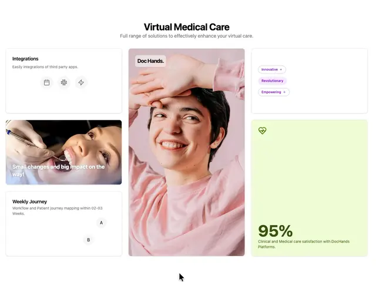

# 'Virtual Medical Care' bento: a tall pink portrait, an integrations card, a dentist photo, pastel tag pills and a lime 95% stat card

**Discipline:** web · **Design type:** Landing page sections
**Tags:** healthcare, bento, pink, lime, portrait, tags, stats, white

## What it is
A white page with a bold centred heading and grey subline above a bento: a central tall portrait of a smiling woman in pink with a 'Doc Hands.' label, a left column with an Integrations card with three round icons, a photo card of a patient with a dental tool captioned 'Small changes and big impact on the way!' and a Weekly Journey card, and a right column with a white card of tag pills (Innovative, Revolutionary, Empowering) and a pale lime card with a heart icon and '95%' satisfaction.

## What it means
Warm and approachable; a soft pink portrait and lime stat make a clinical service feel human.

## Techniques
- Put a tall portrait in the centre of a bento.
- Use a pale lime stat card.
- Mix white cards with photo cards.
- Show tags as small tinted pills.

## Best for
- Telehealth and healthcare landing pages
- Bento layouts
- Pastel stat cards

## Vocabulary
- **Bento centrepiece** — A tall image card anchoring a bento.
- **Stat card** — A card with a large percentage and caption.
- **Tag pill** — A small tinted label.
- **Photo card** — A card whose background is a photo with caption.
