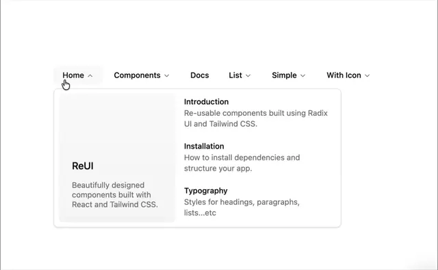

# Top nav 'Home, Components, Docs, List, Simple, With Icon' with an open mega menu: a grey preview card and three titled links

**Discipline:** web · **Design type:** UI components
**Tags:** component, navigation, mega-menu, dropdown, white, grey, hover, minimal

## What it is
A white page with a text nav where 'Home' is active with an up chevron under a cursor, and a bordered white dropdown panel with a soft grey card at the left titled 'ReUI' with a description and, at the right, three items (Introduction, Installation, Typography), each with a bold title and a grey description.

## What it means
Organised and quiet; a preview card plus descriptive links helps choose a destination.

## Techniques
- Open a panel with a preview card and link list.
- Give each link a title and description.
- Mark the active nav item with a chevron.
- Keep it monochrome.

## Best for
- Documentation navigation
- Mega menu components
- Minimal site headers

## Vocabulary
- **Mega menu** — A large dropdown with multiple links and a preview.
- **Preview card** — A card in a menu summarising the section.
- **Descriptive link** — A link with a title and explanatory line.
- **Active chevron** — An arrow showing the open state.
