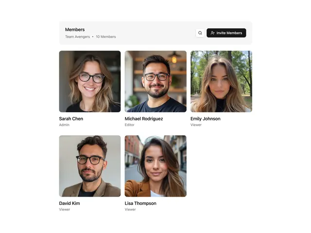

# Members panel with a grey header, search icon and black Invite Members button above a grid of rounded square portraits with names and roles

**Discipline:** web ·  · **Design style:** Photographic & Cinematic
**Tags:** component, members, grid, portraits, white, grey, black-button, roles

## What it is
A white page with a light grey header bar showing 'Members' and 'Team Avengers • 10 Members' with a small search button and a black 'Invite Members' button, and a grid of five rounded-square portrait photos each captioned with a name and a grey role (Admin, Editor, Viewer).

## What it means
Personal and orderly; large faces make a member list feel human.

## Techniques
- Show members as large rounded photos.
- Caption with name and role.
- Add a header with count and actions.
- Use one black primary button.

## Best for
- Team member lists
- Workspace settings
- Photo-based directories

## Vocabulary
- **Member grid** — A grid of member photos with captions.
- **Role label** — A grey caption such as Admin or Viewer.
- **Panel header** — A bar with title, count and actions.
- **Invite button** — A button for adding members.
