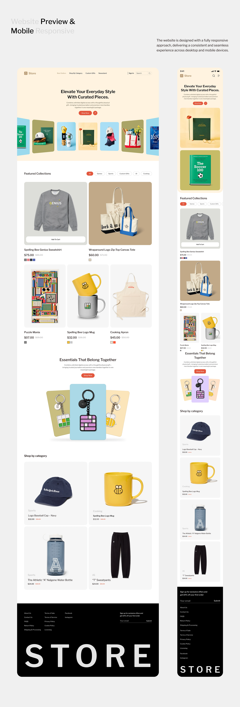

# Merch store desktop and mobile with pastel product cards

**Discipline:** web · **Design type:** E-commerce storefront
**Tags:** e-commerce, merch, responsive, pastel, product-photography, black-footer, giant-wordmark

## What it is
A long preview of a brand store with a cream hero holding a perspective row of coloured product cards, a featured collections grid with white product tiles, a keychain trio on tinted cards, category tiles, and a black footer with a giant spaced 'STORE'. A narrower mobile version sits beside it.

## What it means
Playful and tidy, like a museum shop; colourful product cards on a neutral page make merchandise feel collectable.

## Techniques
- Give each product a tinted square in a different pastel to create a bright shelf.
- Show the mobile and desktop layouts side by side to prove responsiveness.
- Overlap a centre card larger than its neighbours in trios for focus.
- End with a huge letter-spaced wordmark in the footer.

## Best for
- Brand merchandise stores
- Publisher and community shops
- Responsive design showcases

## Vocabulary
- **Tinted product card** — A product on a soft coloured square.
- **Footer wordmark** — An oversized brand name closing the page.
- **Responsive pair** — Desktop and mobile views shown together.
- **Featured collection** — A curated grid at the top of a store.
