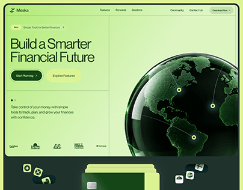

# Meska finance hero in lime green with a glassy green 3D globe and glowing map pins

**Discipline:** web · **Design type:** SaaS landing page · **Design style:** 3D & Surreal
**Tags:** fintech, lime, globe, 3d, hero, saas

## What it is
A lime-to-mint landing page hero with 'Build a Smarter Financial Future' in dark green, 'Start Planning' and 'Explore Features' buttons, partner logos, a large glossy dark-green glass globe with glowing yellow-green pins linked by lines, and a dark band below with a green card and floating app icons.

## What it means
Fresh and global; the tinted glass globe feels premium and signals worldwide reach.

## Techniques
- Tint a 3D globe in the brand colour.
- Mark locations with glowing pins joined by arcs.
- Frame the hero with thin grid lines and a pill badge.

## Best for
- Fintech landing pages
- Global payment products
- SaaS heroes

## Vocabulary
- **Hero section** — The first, most prominent part of a web page.
- **Glass material** — A 3D surface rendered translucent and glossy.
