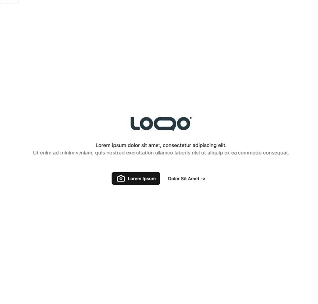

# White hero with a dark teal rounded wordmark, two-line lorem text, a black camera-icon button and an arrow link

**Discipline:** web ·  · **Design style:** Minimalist
**Tags:** hero, white, logo, black-button, centered, minimal, template, teal

## What it is
A white page with a centred dark slate-teal rounded wordmark 'LOOO', a black bold line and a grey second line of placeholder text, and below a black rounded button with a camera icon and a text link 'Dolor Sit Amet ->'.

## What it means
Neutral and open; a stripped hero shows structure before content.

## Techniques
- Stack logo, headline and buttons on a centre line.
- Pair a black filled button with a text link.
- Use dark teal for the logo only.
- Leave generous white space.

## Best for
- Hero templates
- Minimal brand landing pages
- Wireframe-like placeholders

## Vocabulary
- **Centre-line hero** — A hero with everything centred on one axis.
- **Text link secondary** — An arrow link next to a primary button.
- **Placeholder copy** — Lorem ipsum text used in a template.
- **Icon button** — A button with an icon and a label.
