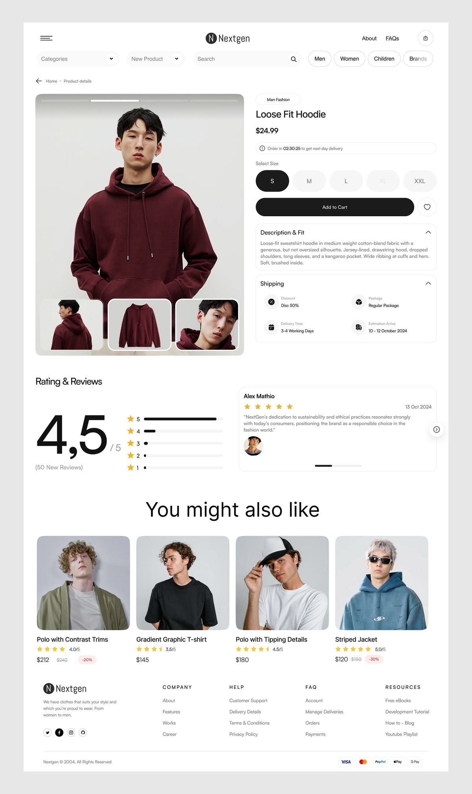

# Minimal fashion PDP with pill size selector, huge rating numeral and rounded photo cards

**Discipline:** web ·  · **Design style:** Minimalist
**Tags:** pdp, fashion, white, black-and-white, pill-buttons, reviews, rounded-images, product-grid

## What it is
A white page with a centred logo and pill filters. A large rounded photo of a hoodie model with thumbnails sits left; on the right title, price, delivery timer, round size pills, wide black Add to Cart with a heart button, and accordions for description and shipping. Below: a giant '4,5' rating with bars, a review card, and 'You might also like' cards with rounded photos, stars and discounts.

## What it means
Clean, contemporary and trustworthy; rounded elements and neutral colour keep focus on the clothes.

## Techniques
- Use fully rounded pills for filters, sizes and buttons.
- Display the rating as a giant numeral next to thin bar rows.
- Set thumbnails inside the main image rounded frame.
- Use rounded product cards with small discount chips.

## Best for
- Fashion and apparel stores
- Minimal e-commerce
- Product detail templates

## Vocabulary
- **Size pill** — A rounded selector for a product size.
- **Rating breakdown** — A list of bars showing the count of each star rating.
- **Thumbnail overlay** — Small images placed inside the main image frame.
- **Discount chip** — A small pink or red tag showing a percentage off.
