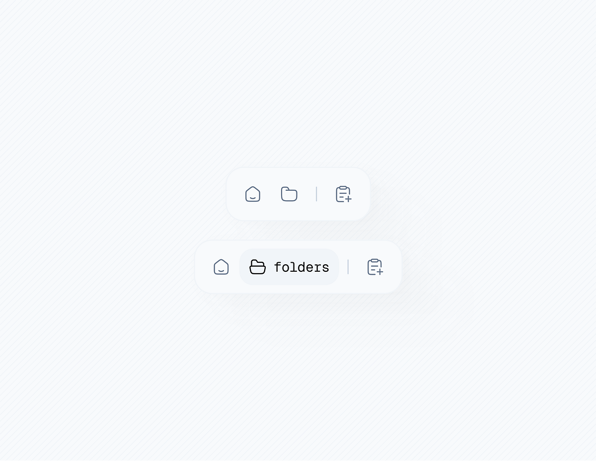

# Minimal Nav Pills Collapsed and Expanded

**Discipline:** web · **Design type:** UI components
**Tags:** nav, pill, minimal, icons, monospace, white, expanded-state

## What it is
A pale hatched-white field with two floating white pill navigations with soft shadows: a compact one of home, folder and add-note icons, and an expanded one where the folder item is highlighted in a pale blue pill with a monospace 'folders' label.

## What it means
Showing the collapsed and expanded state in one image explains the interaction, and a mono label gives a technical feel.

## Techniques
- Collapsed and expanded states shown together
- Active item expanding with a text label
- Thin outline icons
- Monospace label for a technical voice
- Soft shadow on a very light background

## Best for
- Nav component states
- Minimal floating toolbars
- Interaction documentation

## Vocabulary
- **Expanding pill** — A selected item that widens to show its label.
- **Floating toolbar** — A small bar hovering over content.
- **Hatched background** — A faint diagonal line texture.
