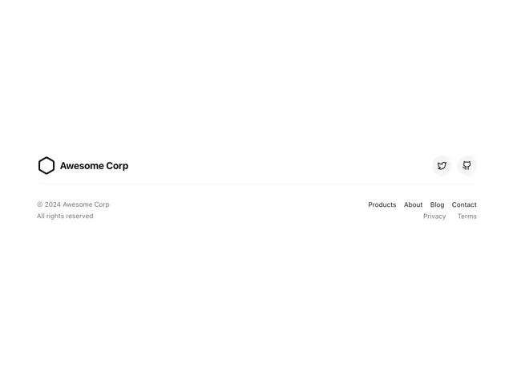

# White footer with a hexagon logo and name, two round social buttons, copyright and right-aligned link columns

**Discipline:** web ·  · **Design style:** Minimalist
**Tags:** component, footer, white, hexagon-logo, social-icons, links, minimal, ui-kit

## What it is
A white frame with a bordered hexagon logo and 'Awesome Corp' at the left, two round grey icon buttons for social links at the right, a hairline, a small copyright at the left and two rows of links (Products, About, Blog, Contact; Privacy, Terms) right-aligned.

## What it means
Tidy and neutral; a footer stripped to essentials.

## Techniques
- Use a simple outlined hexagon logo.
- Round the social icon buttons.
- Right-align link groups.
- Divide with a hairline.

## Best for
- Footer components
- Minimal corporate sites
- UI kits

## Vocabulary
- **Footer link group** — A set of links aligned at the footer's edge.
- **Social icon button** — A round button with a platform icon.
- **Hairline divider** — A very thin separating line.
- **Legal row** — Small links for privacy and terms.
