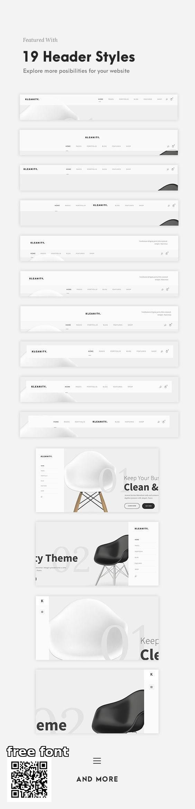

# Minimal Header Styles Catalogue

**Discipline:** web · **Design type:** UI components
**Tags:** header, navigation, minimal, grey, chair, theme, catalogue

## What it is
A tall feature sheet of 19 website header variations for a minimal theme: horizontal bars with centered, split and left logos, and side-menu layouts over a white and black chair hero, plus a free-font QR badge.

## What it means
Listing every variation at small scale shows range at a glance, and the grayscale product photography keeps focus on the layout differences.

## Techniques
- Repeat one component in many variations stacked vertically
- Grayscale palette so structure is the only variable
- A single hero product (chair) shown in light and dark versions
- Ghost numerals behind hero text
- Tiny uppercase nav labels with an underline for the active item

## Best for
- Theme and template marketplace listings
- Navigation component libraries
- Minimal furniture and lifestyle sites

## Vocabulary
- **Header variant** — An alternate arrangement of logo, navigation and utilities.
- **Side navigation** — A vertical menu docked to one side.
- **Ghost numeral** — A large faint number used as background decoration.
