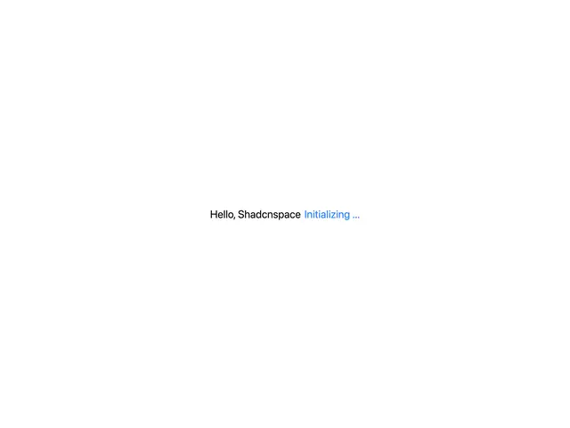

# Minimal Loading Text State

**Discipline:** web ·  · **Design style:** Minimalist
**Tags:** minimal, loading, microcopy, white-space, blue-accent

## What it is
An almost empty white page with one centered line, 'Hello, Shadcnspace' in black followed by 'Initializing ...' in blue, a rolling-text loading state.

## What it means
Extreme restraint makes a moment of waiting feel calm and intentional. The color shift separates the constant from the changing part of the message.

## Techniques
- One line of text as the entire composition, centered with vast negative space
- Set the changing word in a single accent color while the rest stays neutral
- Use a plain system-like sans at modest size so it reads as UI, not decoration
- Animate the changing word by rolling or cycling it in place
- Treat a loading screen as a brand moment rather than a spinner

## Best for
- Splash and loading screens
- Developer tools and component libraries
- Onboarding moments and empty states

## Vocabulary
- **Rolling text** — A word that cycles or scrolls vertically in place to show changing content.
- **Negative space** — Empty area that gives the content room and focus.
- **Accent word** — One word colored differently to mark it as the dynamic or important piece.
