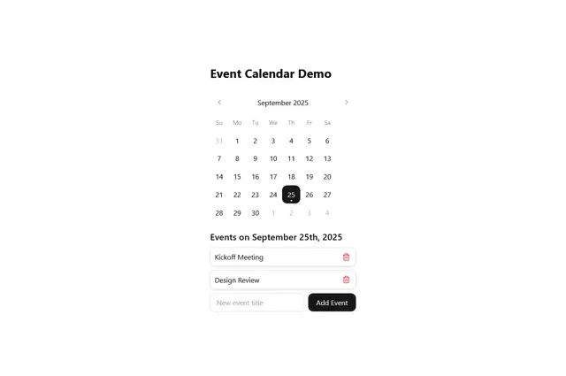

# Event calendar demo: September grid with a black selected day, faded neighbours and a list of events with add field

**Discipline:** web · **Design type:** UI components
**Tags:** component, calendar, white, black, event-list, input, minimal, ui-kit

## What it is
A white page with a bold title, a month header with chevrons, weekday letters, a grid of dates where the selected 25 is a black rounded square with a dot and out-of-month days are pale, then 'Events on September 25th, 2025' with two bordered rows (Kickoff Meeting, Design Review) each with a red trash icon, and a new event input with a black Add Event button.

## What it means
Clean and tidy; black selection and pale neighbours make the date obvious.

## Techniques
- Mark the selected day as a black square.
- Pale out neighbouring months.
- List events below in bordered rows.
- Add an inline input and black button.

## Best for
- Calendar and scheduling components
- Minimal date pickers
- Event list UI

## Vocabulary
- **Selected day** — The chosen date, highlighted.
- **Out-of-month day** — A date from an adjacent month shown faded.
- **Event row** — A bordered list item with a delete icon.
- **Add field** — An input paired with a primary button.
