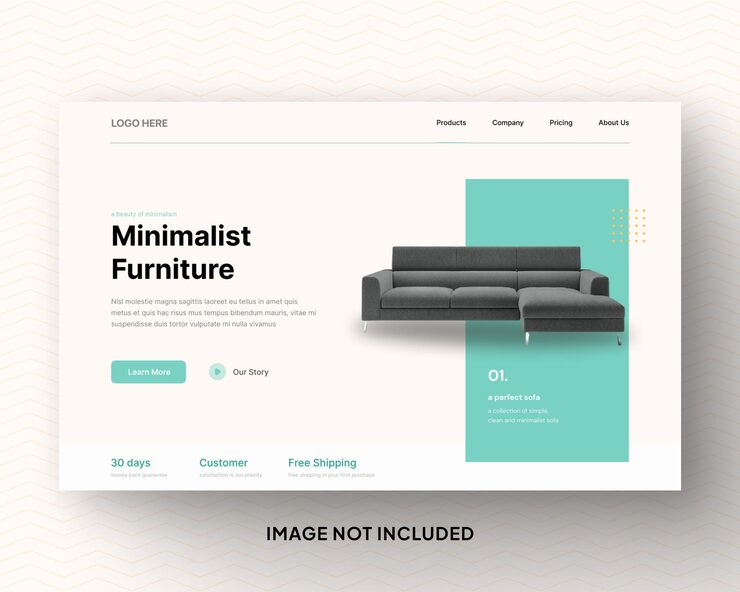

# 'Minimalist Furniture' hero with a sofa breaking out of a mint panel and a trust-stats bar

**Discipline:** web · **Design type:** Landing page hero · **Design style:** Minimalist
**Tags:** furniture, hero, mint, ecommerce, stats, minimal

## What it is
A warm off-white hero with a small mint eyebrow, a bold two-line 'Minimalist Furniture' headline, a mint 'Learn More' button and 'Our Story' play link, a grey sofa overlapping a tall mint panel labelled '01. a perfect sofa' with yellow dots, and a bottom bar with '30 days', 'Customer', 'Free Shipping'.

## What it means
Calm and trustworthy; the product breaking out of its panel adds depth to a simple layout.

## Techniques
- Let the product overlap out of a colour panel.
- Number the featured product like a collection.
- Close the hero with a row of trust stats.
- Pair a solid CTA with a play-icon text link.

## Best for
- Furniture brands
- Home decor stores
- Clean product heroes

## Vocabulary
- **Break-out** — An image extending past its container.
- **Trust bar** — A row of guarantees or stats.
