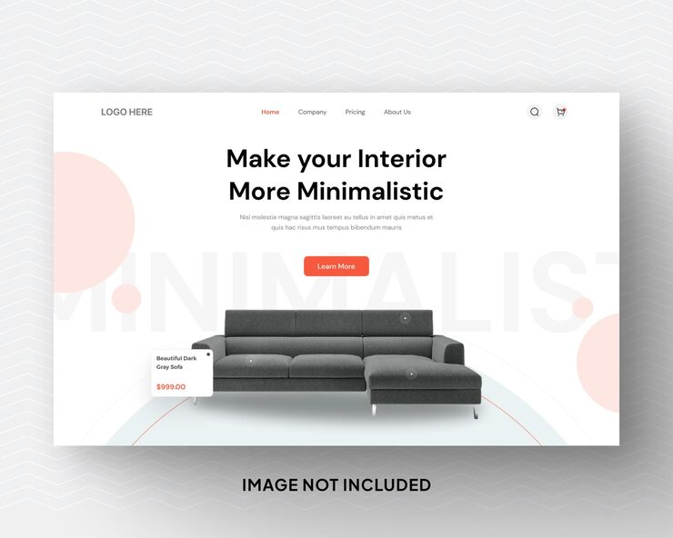

# 'Make your Interior More Minimalistic' hero with a grey sofa, product hotspots and ghost 'MINIMALIST' word

**Discipline:** web · **Design type:** Landing page hero · **Design style:** Minimalist
**Tags:** furniture, hero, ecommerce, coral, hotspots, minimal

## What it is
A white landing page hero with centred nav, a bold centred headline, a coral 'Learn More' button, a grey sectional sofa in the centre with small hotspot dots and a floating product card ('Beautiful Dark Gray Sofa $999.00'), a huge faint 'MINIMALIST' word behind and soft coral circles at the edges.

## What it means
Airy and shoppable; hotspots turn a hero image into a product browser.

## Techniques
- Put a giant ghost word behind the hero product.
- Add hotspot dots with a floating price card.
- Centre everything with soft circles at the edges.
- Use one warm accent for CTA and nav state.

## Best for
- Furniture e-commerce
- Product-first landing pages
- Minimal retail sites

## Vocabulary
- **Hotspot** — A clickable dot on an image revealing details.
- **Ghost text** — Oversized faint text used as background.
