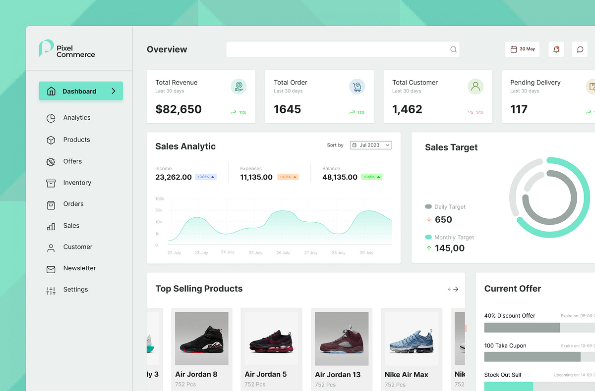

# Mint E-Commerce Admin Overview

**Discipline:** web ·  · **Design style:** Corporate & Clean-Tech
**Tags:** dashboard, mint, commerce, kpi, area-chart, donut, products, sidebar

## What it is
A cropped admin window on a mint geometric backdrop with a sidebar (an active mint Dashboard pill), an Overview header with search and date, four KPI cards with icons and trend arrows, a sales analytic area chart with income, expenses and balance, a sales target ring, a top-selling products carousel with sneaker photos and a current offers card with progress bars.

## What it means
Mint highlights on a neutral grey UI feel fresh, and soft product photos add life to a data-heavy page.

## Techniques
- Mint as the accent for active states and charts
- Area chart with a soft gradient fill
- Concentric ring chart for targets
- Product carousel with grey photo tiles
- Trend arrows in green and red on KPI cards

## Best for
- E-commerce admin dashboards
- Sales analytics
- Mint and grey UI

## Vocabulary
- **Sales target ring** — Concentric arcs comparing daily and monthly targets.
- **KPI trend** — An arrow and percentage showing change.
- **Area chart** — A line chart with the area below filled.
