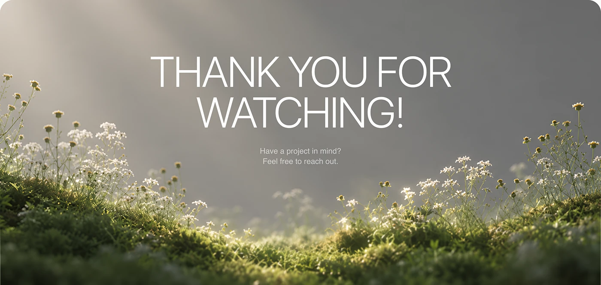

# Thank-you banner with thin white caps over a misty flower meadow

**Discipline:** web · **Design type:** Closing banner
**Tags:** closing, meadow, mist, white-type, nature, thin-caps, banner, calm

## What it is
A wide image of soft-focus wildflowers and moss lit by hazy light with a grey sky. 'THANK YOU FOR WATCHING!' is set in thin white capitals with a short contact line beneath.

## What it means
Peaceful and elegant; natural mist gives a sense of exhale at the end.

## Techniques
- Use a shallow-depth nature photo as a full-bleed closing image.
- Set light-weight caps in white with a small grey subline.
- Leave the sky as open space for text.
- Round the frame's corners to match the deck.

## Best for
- Closing slides of wellness or botanical projects
- Quiet banners and section breaks
- Brands with a natural voice

## Vocabulary
- **Shallow depth** — Photography with a sharply blurred background.
- **Text-in-sky** — Placing text over the empty sky area of a photo.
- **Closing banner** — An image and short message that ends a presentation.
- **Thin caps** — Uppercase text in a light weight.
