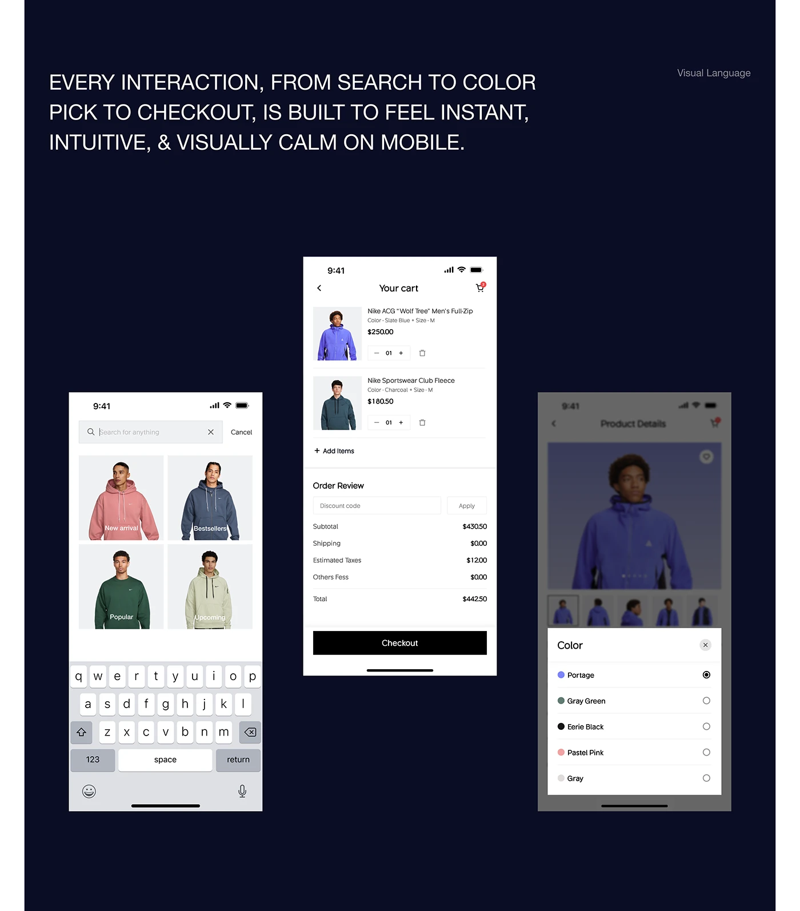

# Mobile fashion flow on navy: search grid, cart and colour bottom sheet

**Discipline:** web · **Design type:** Responsive mobile web
**Tags:** mobile-web, search, cart, colour-picker, bottom-sheet, navy, white-ui, e-commerce

## What it is
A navy board with a large uppercase statement and three phones: a search screen with four labelled product tiles and keyboard, a cart with two products, order review and black checkout button, and a dimmed product page with a bottom sheet listing colour options with radio buttons.

## What it means
Calm and clear; white UI on deep navy shows a straightforward commerce flow.

## Techniques
- Use a dark navy stage with white phones to make screens stand out.
- Label search tiles with white text in the corner.
- Use a modal bottom sheet for option selection with a dimmed page behind.
- End the cart with one black wide button.

## Best for
- Mobile commerce flow presentations
- Cart and checkout UX
- Fashion app case studies

## Vocabulary
- **Bottom sheet** — A panel sliding up from the bottom.
- **Dimmed backdrop** — A darkened background behind a modal.
- **Order review** — A summary of costs before checkout.
- **Radio list** — A vertical list where one option is selected.
