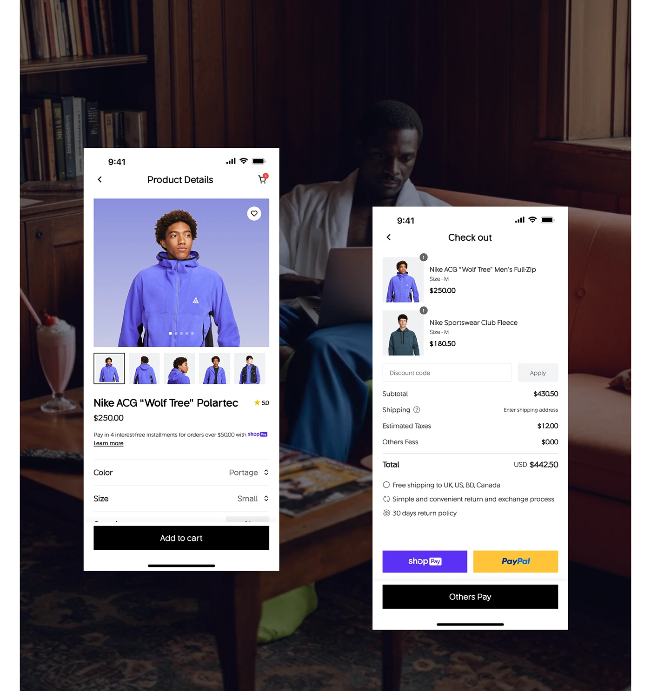

# Two white phone screens (product details and checkout) over a moody dark interior photo of a man on a sofa

**Discipline:** web ·  · **Design style:** Dark & Neon
**Tags:** mobile-web, product-page, checkout, dark-photo, black-button, violet, express-pay, fashion

## What it is
A dark warm-toned photo of a man reading in an armchair with a milkshake beside him, overlaid with two staggered white mobile screens: a product detail with a violet-backdrop model, thumbnail strip, price, colour and size selectors and a black Add to cart, and a checkout with two items, discount code, cost lines, benefit list, violet and yellow express buttons and a black Others Pay button.

## What it means
Warm and cinematic; bright UI over a dim lifestyle scene draws attention to the flow.

## Techniques
- Overlay white screens on a dark editorial photo.
- Stagger the two phones.
- Keep buttons black with brand-coloured express pay.
- Use a violet product backdrop as accent.

## Best for
- Fashion app flow showcases
- Product and checkout screens
- Lifestyle-photo presentations

## Vocabulary
- **Screen over photo** — UI screens placed on a full-bleed photo.
- **Thumbnail strip** — Small product photos below the main image.
- **Express pay** — Coloured quick-checkout buttons.
- **Staggered screens** — Screens placed at different heights.
