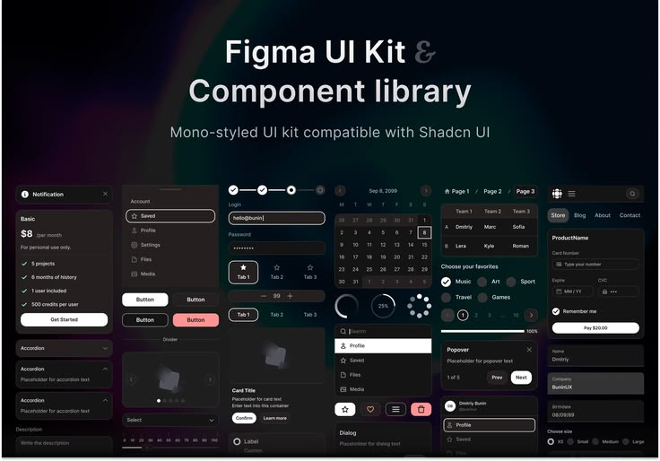

# Mono Dark UI Kit Component Library

**Discipline:** web · **Design type:** UI components
**Tags:** ui-kit, components, dark, monochrome, shadcn, figma, library

## What it is
A dark overview poster titled 'Figma UI Kit & Component library' above a dense grid of monochrome components: notification, pricing card, accordions, buttons, steppers, calendar, tabs, dropdowns, popovers, form fields.

## What it means
Showing dozens of components at once demonstrates completeness, and the greyscale keeps the emphasis on structure and consistency.

## Techniques
- Multi-column collage of components in one dark palette
- Single soft accent (pink button) among neutrals
- Large two-tone title with a faint ampersand
- Subtle aurora glow behind the title
- States shown side by side (selected, hover, disabled)

## Best for
- UI kit marketplace previews
- Design-system marketing
- Developer-friendly component libraries

## Vocabulary
- **Component library** — A set of reusable interface elements.
- **Mono-styled** — Using only neutral greys and black/white.
- **Component collage** — Many components arranged together as an overview.
