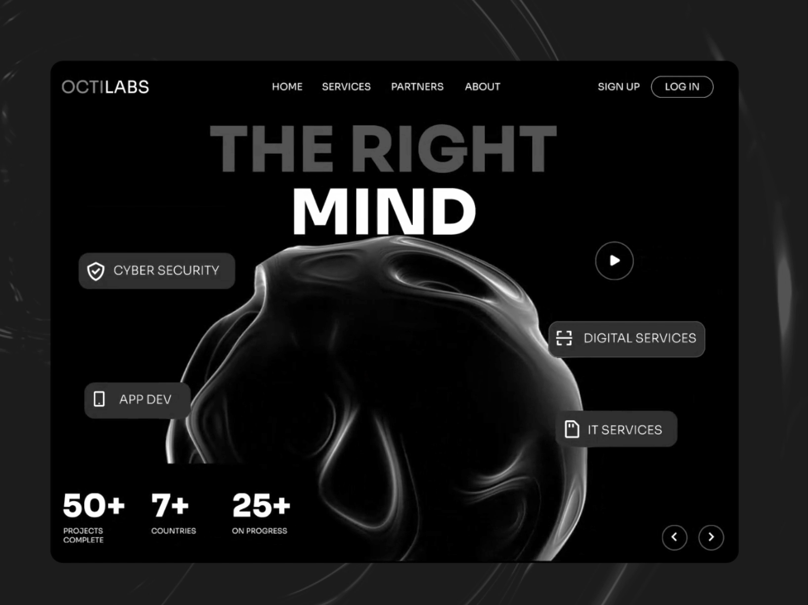

# Monochrome 3D Blob Agency Hero

**Discipline:** web · **Design type:** Landing page hero
**Tags:** monochrome, 3d, black-white, agency, hero, chips, stats

## What it is
A grayscale hero in a rounded black frame: a giant bold headline 'THE RIGHT MIND' half faded, a glossy dark organic 3D form behind it, floating service chips, a play button, three stats and carousel arrows.

## What it means
Without color, the form and typography carry the whole mood: sleek, intelligent, slightly mysterious. The fading top line adds depth.

## Techniques
- Huge heavy caps with one line dimmed for hierarchy
- Glossy abstract 3D object with rim light against black
- Service chips floating around the object like labels
- Stats row in the lower left with tiny captions
- Strict grayscale with white as the only bright

## Best for
- Tech and IT service agencies
- Concept and portfolio pieces
- Brands wanting a premium, futuristic feel

## Vocabulary
- **Rim light** — Light along an object's edges that separates it from the background.
- **Floating chips** — Small pills placed around a visual as labels.
- **Dimmed line** — One text line set at lower contrast to create depth.
