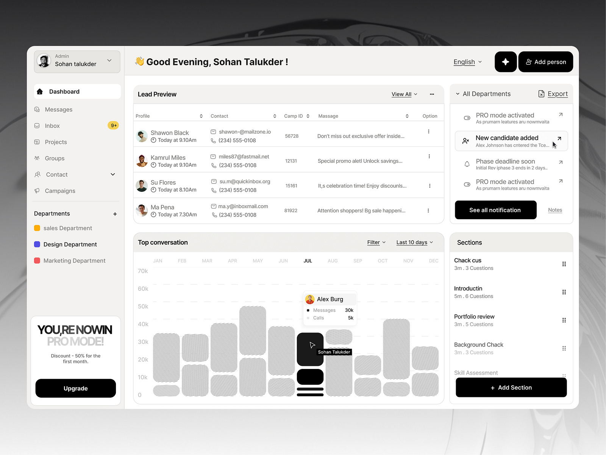

# Monochrome CRM Dashboard with Hatched Bars

**Discipline:** web ·  · **Design style:** Corporate & Clean-Tech
**Tags:** dashboard, crm, monochrome, hatched-bars, black-buttons, table, cream

## What it is
A cream and white CRM dashboard on a grey backdrop with a sidebar, a lead preview table, notifications, a bar chart of rounded hatched bars with one solid black bar and a tooltip, a lesson sections list and a pro upsell card, with black buttons for actions.

## What it means
Hatched bars and black buttons give a crisp, editorial look, and a single solid bar shows the selection.

## Techniques
- Rounded hatched bars as chart texture
- One solid black bar as the selected value
- Black pill buttons as the only strong contrast
- Cursor and name tag showing collaboration
- Warm cream panels on a light shell

## Best for
- CRM and admin dashboards
- Monochrome data UI
- Upsell and notification panels

## Vocabulary
- **Hatched bar** — A bar filled with fine lines instead of solid colour.
- **Tooltip card** — A floating card showing details of a hovered value.
- **Upsell card** — A sidebar card promoting a paid plan.
