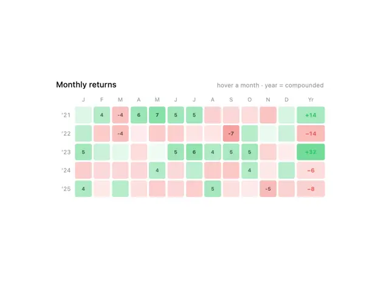

# Monthly returns heatmap: rows per year, cells tinted green for gains and red for losses, with yearly totals on the right

**Discipline:** web ·  · **Design style:** Corporate & Clean-Tech
**Tags:** chart, heatmap, finance, green, red, white, grid, returns

## What it is
A white card titled 'Monthly returns' with a grey hint 'hover a month · year = compounded', a header row of month initials and 'Yr', five year rows ('21 to '25) of rounded square cells in soft green or red where stronger tints carry numbers (4, -4, 6, 7, -7) and a bold coloured yearly total (+14, -14, +32, -6, -8).

## What it means
Readable at a glance; tint intensity encodes size and colour encodes direction.

## Techniques
- Tint cells by value in two hues.
- Print numbers only in the strong cells.
- Bold the yearly total.
- Use rounded square cells with gaps.

## Best for
- Investment performance tables
- Heatmap components
- Calendar-like data grids

## Vocabulary
- **Heatmap** — A grid whose cell colours encode values.
- **Diverging colour** — Two hues for positive and negative values.
- **Year total** — A summary cell for a row.
- **Cell tint** — The strength of colour showing magnitude.
