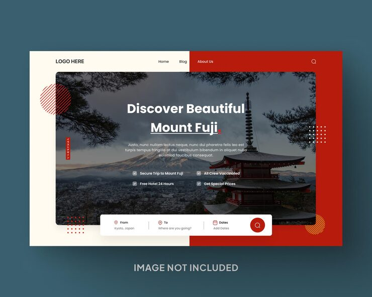

# 'Discover Beautiful Mount Fuji' hero with red split background and floating booking search bar

**Discipline:** web · **Design type:** Landing page hero · **Design style:** Photographic & Cinematic
**Tags:** travel, japan, hero, red, booking, search

## What it is
A hero split into cream and crimson halves with a rounded photo of Mount Fuji and a pagoda, a centred white headline with underlined 'Mount Fuji', four checklist perks, a floating white search bar (From, To, Dates) with a red circle search button, and red striped circles and dot grids.

## What it means
Inviting and cultural; the red nods to Japan while the booking bar makes it actionable.

## Techniques
- Split the background into two colours behind a photo.
- Float a booking bar across the photo's bottom edge.
- List perks as a checklist in the hero.
- Use striped circles as accents.

## Best for
- Travel booking sites
- Destination landing pages
- Tour operators

## Vocabulary
- **Booking bar** — A search form for trips with fields and a button.
- **Split background** — Two colour blocks side by side.
